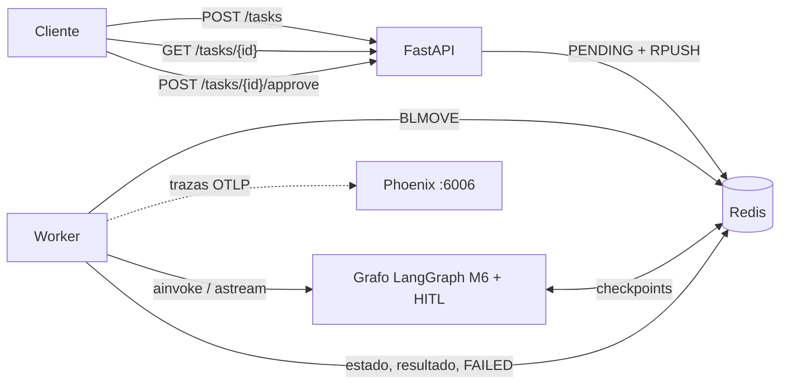
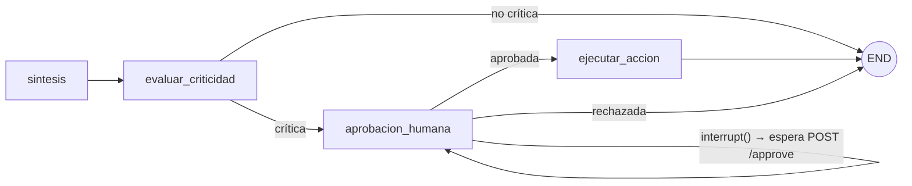
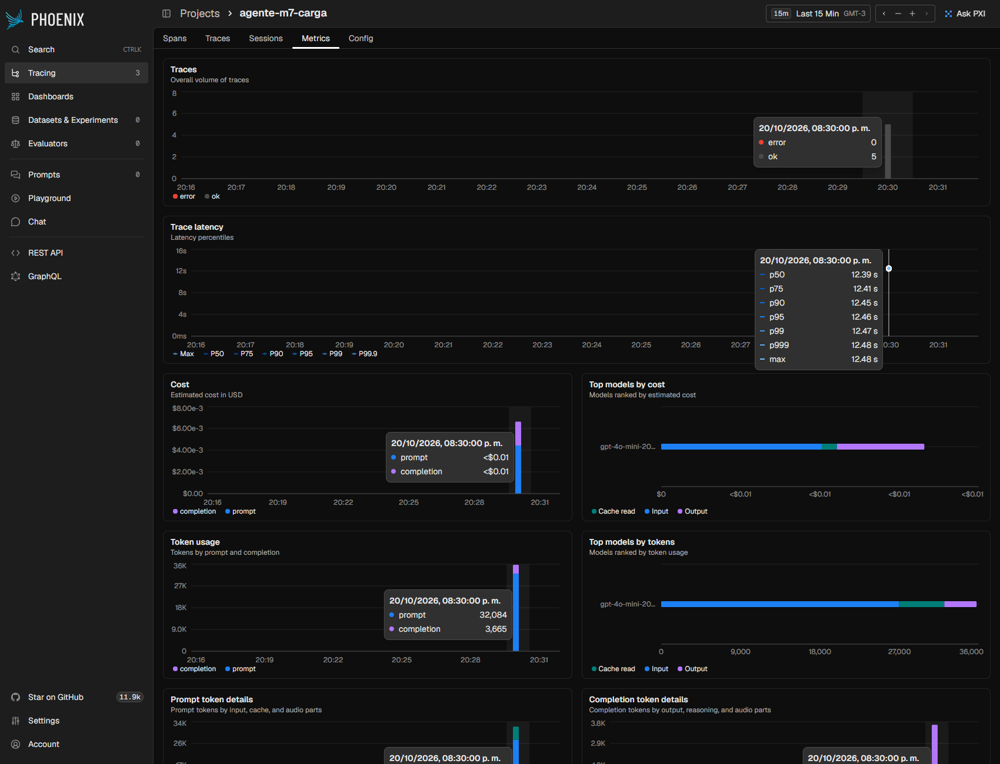

# API de producción para el orquestador multi-agente (Pre-entrega 7)

API REST (FastAPI) que expone el orquestador multi-agente del Módulo 6 con cuatro capacidades de producción:

| Capacidad | Cómo se resuelve | Dónde |
|---|---|---|
| **Endpoints asíncronos** | `POST /tasks` valida, guarda el job como `PENDING`, lo encola y responde `202` + `job_id` en milisegundos. El trabajo lo hace un **worker**; el cliente consulta con `GET /tasks/{id}` (polling). | `app/main.py`, `app/worker.py` |
| **Estado en Redis** | Estado de cada job (`PENDING → RUNNING → WAITING_APPROVAL → DONE / FAILED`), cola confiable (`BLMOVE`), latidos del worker y **checkpoints de LangGraph** (`AsyncRedisSaver`). Si el agente falla, el job queda en `FAILED` con el error. | `app/jobs.py`, `app/graph.py` |
| **Observabilidad** | Trazas de cada nodo, llamada al LLM y herramienta hacia **Arize Phoenix** (OpenInference) o LangSmith. Una traza por job, agrupada en una *sesión* (job + reanudación). | `app/observability.py` |
| **Human-in-the-loop** | Si la consulta pide una **acción con efectos secundarios** (enviar el resultado por correo a RRHH), el grafo se **pausa** con `interrupt()` hasta que alguien llame a `POST /tasks/{id}/approve`. El estado sobrevive al reinicio de la API. | `app/hitl.py` |



Grafo (la parte nueva es todo lo que sigue a `sintesis`; el resto es el orquestador del M6):



## Requisitos

- Python 3.12
- **Redis 8** (o `redis/redis-stack-server`): el checkpointer de LangGraph necesita los módulos RedisJSON y RediSearch, que Redis 8 trae de fábrica. Un Redis "común" anterior a 8 **no sirve** (ver *Problemas frecuentes*).
- Docker (recomendado) para Redis y Phoenix.
- Una API key de OpenAI (o Anthropic, con `LLM_PROVIDER=anthropic`) en `.env`.

## Puesta en marcha (local)

```powershell
# 1) Entorno                                  (Linux/macOS: python3.12 -m venv .venv && source .venv/bin/activate)
py -3.12 -m venv .venv
.\.venv\Scripts\Activate.ps1
pip install -r requirements.txt
copy .env.example .env                        # Linux/macOS: cp .env.example .env
#    → completá OPENAI_API_KEY (o ANTHROPIC_API_KEY + LLM_PROVIDER=anthropic). Dejá OBSERVABILITY=phoenix.

# 2) Redis 8 y Phoenix
docker run -d --name redis   -p 6379:6379 redis:8
docker run -d --name phoenix -p 6006:6006 -p 4317:4317 arizephoenix/phoenix:version-20.23.0

# 3) API (con WORKER_EMBEDDED=true el worker corre dentro del mismo proceso)
uvicorn app.main:app --host 127.0.0.1 --port 8000
```

- Documentación interactiva: <http://127.0.0.1:8000/docs> · Phoenix: <http://127.0.0.1:6006>
- Comprobación rápida: `Invoke-RestMethod http://127.0.0.1:8000/health` → `status: ok, redis: ok, ...` (Linux/macOS: `curl localhost:8000/health`).
- **Windows:** usá `127.0.0.1` y no `localhost`. PowerShell/httpx intentan primero IPv6 (`::1`) y, como uvicorn escucha solo en IPv4, cada conexión nueva paga **~2 s** de espera: el `POST /tasks` pasa de ~15 ms a ~2 s sin que la API tenga nada que ver.

### Con Docker Compose (API + worker + Redis + Phoenix)

```powershell
copy .env.example .env        # completá la API key
docker compose up -d --build
docker compose up -d --scale worker=3     # opcional: más workers (el estado está en Redis, escalan solos)
```

La API y el worker son contenedores distintos (`WORKER_EMBEDDED=false`); Phoenix queda fijado en `version-20.23.0` (la misma imagen que `latest` al 2026-10-20).

## Cómo probar

### 1) Un job, a mano

```powershell
$q = "Un empleado lleva 12 años en TechCorp. ¿Cuántos días de vacaciones tiene por año y cuántos suma en 3 años?"
$body = [Text.Encoding]::UTF8.GetBytes((@{ query = $q } | ConvertTo-Json))        # ← bytes UTF-8 (ver "Problemas frecuentes")
$r = Invoke-RestMethod -Method Post -Uri http://127.0.0.1:8000/tasks -ContentType "application/json; charset=utf-8" -Body $body
$r        # → job_id, status = PENDING   (202 + cabecera Location: /tasks/<job_id>)

Invoke-RestMethod http://127.0.0.1:8000/tasks/$($r.job_id)
# → PENDING → RUNNING (progress: supervisor, investigador, validador, ...) → DONE (result.respuesta: "28 días por año ... 84")
```

Linux/macOS:

```bash
curl -s -X POST localhost:8000/tasks -H "Content-Type: application/json" \
  -d '{"query":"Un empleado lleva 12 años en TechCorp. ¿Cuántos días de vacaciones tiene por año y cuántos suma en 3 años?"}'
curl -s localhost:8000/tasks/<job_id>
```

Si hay `API_KEY` en `.env`, agregá el header `X-API-Key: <valor>` a todas las llamadas (salvo `/health`).

### 2) Las 5 peticiones concurrentes (prueba de carga)

```powershell
python -m scripts.load_test --base-url http://127.0.0.1:8000 --n 5
```

Lanza 5 `POST /tasks` a la vez, mide cuánto tarda cada `202` (milisegundos), comprueba que `GET /health` sigue respondiendo mientras los jobs corren, espera a que todos terminen y muestra p50/p95 medidos en el cliente. Guarda el detalle en `screenshots/carga_<fecha>.json`. Termina con código 1 si algún job falló.

### 3) Human-in-the-loop (tarea crítica)

La consulta pide enviar un correo → el sistema lo detecta como crítico y **se detiene antes de ejecutar**:

```powershell
$q = "Un empleado lleva 12 años en TechCorp. ¿Cuántos días de vacaciones tiene por año y cuántos suma en 3 años? Envía el resultado por correo a RRHH."
$body = [Text.Encoding]::UTF8.GetBytes((@{ query = $q } | ConvertTo-Json))
$r = Invoke-RestMethod -Method Post -Uri http://127.0.0.1:8000/tasks -ContentType "application/json; charset=utf-8" -Body $body

Invoke-RestMethod http://127.0.0.1:8000/tasks/$($r.job_id)
# → status = WAITING_APPROVAL, approval_request.accion = { tipo: notificar_rrhh, destinatario: rrhh@techcorp.example, ... }

Invoke-RestMethod http://127.0.0.1:8000/outbox          # → [] (todavía no se envió nada)

Invoke-RestMethod -Method Post -Uri http://127.0.0.1:8000/tasks/$($r.job_id)/approve -ContentType "application/json" `
  -Body '{"aprobado": true, "revisor": "ana", "comentario": "ok"}'
# → 202 · el job vuelve a PENDING y un worker reanuda el grafo → DONE con "✔ Acción ejecutada tras aprobación humana"

Invoke-RestMethod http://127.0.0.1:8000/outbox          # → un "correo" registrado (efecto simulado, idempotente)
```

- Con `{"aprobado": false}` el job termina en `DONE` con `"✘ Acción rechazada por el revisor"` y `/outbox` no cambia.
- Aprobar dos veces (o cinco a la vez) responde `409` salvo a la primera: la transición `WAITING_APPROVAL → PENDING` es atómica.
- **Prueba de reinicio:** con el job en `WAITING_APPROVAL`, detené y volvé a levantar la API y luego aprobalo: funciona, porque el estado vive en Redis (job + checkpoint de LangGraph) y no en memoria.

Si el modelo no completa la parte "informativa" de la consulta (el validador del M6 escala a revisión humana), el job termina en `DONE` con `estado_final = REQUIERE_REVISION_HUMANA` y **no** llega a la compuerta: no se propone ni se envía ninguna acción.

### 4) Errores y borde

| Caso | Respuesta |
|---|---|
| `job_id` inexistente o vencido | `404` |
| Cuerpo inválido (`query` vacía, campos extra, `job_id` que no es UUID en `/approve`) | `422` |
| Más de `QUEUE_MAX_LEN` jobs pendientes | `429` + `Retry-After` |
| Falta o es incorrecta la `X-API-Key` (si `API_KEY` está definida), incluso con caracteres no ASCII | `401` |
| Aprobar un job que no está en `WAITING_APPROVAL` | `409` |
| El agente lanza una excepción / se pasa de `JOB_TIMEOUT_S` | el job queda `FAILED` con el `error` (nunca queda colgado) |
| El worker muere a mitad de un job | otro worker lo recupera (se reencola; tras `MAX_ATTEMPTS` → `FAILED`) |

## Observabilidad: qué mirar en Phoenix

Abrí <http://127.0.0.1:6006> → proyecto **`agente-m7`** (se crea solo en la primera traza). Para aislar la corrida de evidencia se usó un proyecto limpio (`PHOENIX_PROJECT_NAME=agente-m7-carga`). Después de correr `python -m scripts.load_test --n 5`:

1. **Traces**: una traza `tarea_multiagente` por job; al abrirla se ve el árbol de spans (supervisor, investigador, analista, validador, síntesis, cada llamada al LLM y cada herramienta) con tokens y latencia.
2. **Metrics** (con el selector de tiempo en *Last 15 Min* para aislar la corrida):
   - **Trace latency**: percentiles P50 / P75 / P90 / **P95** / P99.
   - **Cost**: costo estimado en USD (Phoenix lo calcula solo a partir de los tokens y del nombre del modelo) y **Top models by cost**.
3. **Sessions**: cada job es una sesión (la ejecución inicial y la reanudación tras la aprobación quedan juntas).

### Evidencia de la corrida (5 peticiones concurrentes, LLM real `gpt-4o-mini`, 2026-10-20 20:30–20:31)

| Archivo | Contenido |
|---|---|
| [`01_traces.png`](screenshots/01_traces.png) | las 5 trazas `tarea_multiagente` con latencia, tokens y costo por traza |
| [`02_metrics_p95_costo.png`](screenshots/02_metrics_p95_costo.png) | pestaña Metrics completa (*Last 15 Min*): latencia, costo y tokens |
| [`02a_latencia_p95.png`](screenshots/02a_latencia_p95.png) | **latencia P95** (tooltip: p50 12,39 s · p95 12,46 s · p99 12,47 s) |
| [`02b_costo_por_ejecucion.png`](screenshots/02b_costo_por_ejecucion.png) | **costo** y tokens del período (32.084 prompt + 3.665 completion) |
| [`03_sessions.png`](screenshots/03_sessions.png) | 5 sesiones, una por job |
| [`04_detalle_de_traza.png`](screenshots/04_detalle_de_traza.png) | árbol de spans de una traza, con tokens y metadata (`job_id`, `prompt_versions`) |



Las capturas se generan con `python -m scripts.capturar_dashboard --proyecto agente-m7-carga --tooltips` (requiere `pip install playwright`; usa un Chrome/Edge ya instalado con `--chromium <ruta>` o `playwright install chromium`). `02a`/`02b` llevan el cursor sobre el punto/barra porque las 5 peticiones caen en un solo intervalo de tiempo y, sin tooltip, P95 y costo serían un punto sin valor legible. El número exacto sale de `python -m scripts.p95_report --project agente-m7-carga --last-minutes 15` (guardado en [`screenshots/p95_agente-m7-carga.json`](screenshots/p95_agente-m7-carga.json)); el detalle de la prueba, en [`screenshots/carga_20261020_203110.json`](screenshots/carga_20261020_203110.json).

### Lectura de la corrida

**Cliente (`scripts/load_test.py`, `--n 5`):** los 5 jobs terminaron `DONE`. `POST /tasks` respondió `202` en **42–76 ms** (máx. 75,8 ms) mientras el agente tardaba ~13 s; `GET /health` respondió durante toda la carga con un máximo de **48,9 ms** y 0 fallos (el event loop no se bloquea). Tiempo total: **13,0 s de pared** para los 5 jobs (en serie habrían sido ≈65 s: corren de verdad en paralelo).

**Phoenix (span raíz `tarea_multiagente`, n = 5, 0 spans con error):**

| Métrica | Valor |
|---|---|
| Latencia p50 / **p95** / p99 | 12,39 s / **12,46 s** / 12,47 s |
| Costo total (Phoenix → Cost) | USD 0,0066 (prompt 0,0044 + completion 0,0022) |
| **Costo por ejecución** | **≈ USD 0,0013** (0,001326) |
| Tokens | 32.084 prompt + 3.665 completion = 35.749 (≈ 7.150 por ejecución) |

- **P95 vs P50:** la diferencia es de ~0,07 s. Es esperable: son 5 jobs idénticos, con `WORKER_CONCURRENCY=5` ninguno espera en cola y cada uno hace la misma secuencia de llamadas (los percentiles se separarían con más peticiones que workers: la espera en cola entra en la latencia que ve el cliente, no en la traza).
- **Dónde se concentra la latencia:** el grafo es secuencial y casi todo el tiempo son llamadas al LLM (≈ 94 % de los 12,4 s por job; herramientas y validador cuestan milisegundos). Por nodo, sobre las 5 ejecuciones: **supervisor 21,8 s (37 %)**, investigador 18,5 s (32 %), analista 12,0 s (21 %), síntesis 6,1 s (10 %).
- **Qué nodo consume más tokens:** el **supervisor, con 16.545 tokens (46 %)**; investigador 9.738 (27 %), analista 7.461 (21 %), síntesis 2.005 (6 %). Es el que más pesa porque se invoca 3 veces por consulta (→ investigador, → analista, → FINISH) y cada vez recibe el estado acumulado. Una palanca de costo/latencia: un modelo más chico para el supervisor (`SUPERVISOR_MODEL`) o recortar el estado que se le envía.
- **Reintentos del validador:** ninguno. Cada job hizo exactamente `supervisor → investigador → validador → supervisor → analista → validador → supervisor → síntesis`.

> El costo por traza que muestra la tabla *Traces* aparece como `<$0.01` (Phoenix lo redondea); el valor exacto se obtuvo del resumen de costos del proyecto (GraphQL de Phoenix: `costSummary`) y se dividió por las 5 trazas.

Para usar **LangSmith** en lugar de Phoenix: `OBSERVABILITY=langsmith`, `LANGSMITH_API_KEY=...`, `LANGSMITH_PROJECT=agente-m7`. Las capturas equivalentes están en *Project → Monitor*. **No fue ejecutado contra LangSmith** (solo cubierto por un test de validación de la key).

## Configuración (`.env`)

Todas las variables están documentadas en `.env.example`. Las más importantes:

| Variable | Default | Para qué |
|---|---|---|
| `REDIS_URL` | `redis://localhost:6379/0` | Redis (estado, cola y checkpoints). Usar la **base 0**: RediSearch no crea índices en otras bases |
| `WORKER_EMBEDDED` | `true` | `true`: worker dentro de la API (desarrollo). `false` + `python -m app.worker`: proceso aparte |
| `WORKER_CONCURRENCY` | `5` | jobs simultáneos por worker |
| `JOB_TIMEOUT_S` | `300` | tope de un job; al pasarlo queda `FAILED` |
| `CHECKPOINTER` | `redis` | `redis` (producción) o `memory` (solo tests) |
| `OBSERVABILITY` | `phoenix` | `phoenix`, `langsmith` o `none` |
| `API_KEY` | vacío | si se define, exige el header `X-API-Key` |
| `RECURSION_LIMIT` | `40` | la compuerta HITL suma pasos al grafo del M6 (que usaba 30) |

> En `.env` **no pongas comentarios en la misma línea de un valor vacío** (`API_KEY=   # nota`): `docker compose` (`env_file`) los toma como valor y la API queda con una clave basura. Los comentarios van en su propia línea.

## Tests y calidad

```powershell
pytest -q                      # 108 tests offline (Redis y LLM falsos) + 3 de integración que se omiten sin REDIS_URL
$env:REDIS_URL="redis://localhost:6379/0"; pytest tests/api/test_integracion_redis.py -q   # contra un Redis 8 real (3 tests)
ruff check . ; ruff format --check . ; mypy
```

Los tests cubren: encolado sin bloquear, `FAILED` ante excepciones y timeouts, 5 jobs concurrentes, recuperación de jobs huérfanos, cancelación, doble aprobación (`409`), pausa/aprobación/rechazo del HITL, autenticación (incluido un header no ASCII), trazas (exportador en memoria) y —contra Redis real— la reanudación tras reiniciar el proceso. La suite es **hermética**: ignora el `.env` del desarrollador (`tests/conftest.py`), así que da lo mismo con o sin él.

## Estructura

```
├── app/                     # Pre-entrega 7
│   ├── main.py              #   FastAPI: POST /tasks · GET /tasks/{id} · GET /health  (+ router de hitl.py)
│   ├── worker.py            #   cola confiable, ejecución del grafo, FAILED, latidos, reanudación
│   ├── jobs.py              #   JobStore: estado en Redis, transiciones atómicas, cola, huérfanos
│   ├── graph.py             #   grafo del M6 + HITL + checkpointer de Redis
│   ├── hitl.py              #   detector de tarea crítica, interrupt(), acción idempotente, POST /approve
│   ├── observability.py     #   Phoenix / LangSmith, span raíz por job, metadata y tags
│   ├── runtime.py · deps.py · settings.py · schemas.py
├── scripts/                 # load_test.py (5 concurrentes) · capturar_dashboard.py · p95_report.py
├── tests/api/               # tests de la API (los del M6 siguen en tests/)
├── screenshots/             # capturas del dashboard + JSON de la prueba de carga (evidencia)
├── docs/README_M6_orquestador.md   # README del orquestador original (agentes, validaciones, prompts)
├── state.py graph.py agents/ tools/ ...   # orquestador del M6 (cambios mínimos: ver abajo)
├── Dockerfile · docker-compose.yml · requirements.txt · requirements-api.txt · .env.example
```

Cambios sobre el código del M6 (todo lo demás quedó intacto y sus 56 tests siguen en verde):
`schemas.py` (+ modelos de la acción y la decisión humana), `state.py` (+ 3 campos), `graph.py` (`compilar(..., checkpointer=, extender=)` para enchufar la compuerta HITL y el checkpointer sin tocar la topología original), `prompts.py` (`investigador-v1 → v2`, ver abajo) y `tests/conftest.py` (suite hermética).

## Decisiones de diseño (resumen)

- **Cola con Redis `LIST` + `BLMOVE`** (cola confiable): un job tomado queda en `processing` hasta que el worker lo confirma; si el worker muere, otro lo recupera. Más simple que Celery/Arq y suficiente a esta escala; el estado del job es independiente de la cola.
- **El estado `PENDING` se escribe antes de encolar** y toda transición es atómica (`WATCH/MULTI`): sin 404 por carreras y sin dobles aprobaciones.
- **HITL determinístico**: la criticidad la decide código (verbo de acción + destino), no un LLM; es conservador a propósito (ante la duda, pide aprobación). El efecto secundario vive en el nodo *siguiente* al `interrupt()` porque al reanudar el nodo se re-ejecuta desde el principio, y es idempotente (`HSETNX`).
- **Una traza por job**: el tracing HTTP nativo de FastAPI está desactivado para que el polling no ensucie las métricas de Phoenix.

## Qué se verificó (y qué no)

Todo se ejecutó en **Windows 11 + PowerShell**, Python 3.12, Redis 8.10.2, Phoenix 20.23.0 y **OpenAI `gpt-4o-mini` real**.

| Verificado | Cómo |
|---|---|
| `pytest -q` → 108 passed, 3 skipped; con Redis 8 real → 111 passed; `ruff`, `ruff format --check`, `mypy --strict` en verde | local |
| Escenarios de punta a punta con el LLM real: endpoint asíncrono, 5 concurrentes, HITL aprobar / rechazar, 5 aprobaciones simultáneas (1×`202` + 4×`409`, un solo correo), **reinicio de la API con el job pausado**, `FAILED` por `JOB_TIMEOUT_S=1`, `401`/`404`/`409`/`422`/`429` | scripts en la sesión de desarrollo |
| **Docker Compose** (`docker compose up -d --build`): API + worker (procesos separados) + Redis + Phoenix, `--scale worker=3`, y **worker muerto con `docker kill`** → el job se recupera (45 s, `attempts=2`) y termina `DONE` | local |
| Phoenix recibe tokens y modelo reales y **calcula el costo** (USD) | dashboard + GraphQL |

| No verificado | |
|---|---|
| **LangSmith** (`OBSERVABILITY=langsmith`) | solo test de validación de la key; nunca ejecutado contra LangSmith |
| Backend `pinecone` del M6 | sin cambios, sin verificar |
| Linux/macOS | el código se desarrolló y probó en Windows (el PRD original lo verificó en Linux) |

Limitaciones conocidas de diseño (no son bugs): el detector de criticidad es conservador y por reglas (puede pedir aprobación de más; no detecta acciones que no mencionen verbo + destino); la acción es simulada (outbox en Redis), no envía un correo real; un job `WAITING_APPROVAL` expira con `JOB_TTL_S` (24 h) y su checkpoint con `CHECKPOINT_TTL_MIN`; el polling es el único mecanismo de seguimiento.

## Hallazgos de la implementación (desvíos respecto del PRD)

Al ejecutar todo contra el sistema real aparecieron cinco cosas que los tests con simuladores no podían ver:

1. **El investigador podía entrar en un bucle de búsquedas.** Con el LLM real, a veces el supervisor pedía "la acumulación de días en 3 años" (un dato que las políticas no traen) y el investigador repetía consultas casi idénticas durante 60 s hasta el timeout del M6 → `REQUIERE_REVISION_HUMANA`. Pasó en 2 de 4 jobs críticos de una primera tanda (y en otro no crítico). El prompt dejaba llamar a la herramienta "más de una vez" sin tope. Se subió a **`investigador-v2`** (máx. 3 búsquedas, sin repetir consultas, devolver `parcial`/`sin_evidencia` en vez de insistir). Con `v2`, los 4 jobs críticos de la verificación final llegaron a `WAITING_APPROVAL` al primer intento (muestra chica: no es una garantía estadística). La evidencia de `screenshots/` es de la corrida con `v2`.
2. **`API_KEY=   # comentario` rompía el Compose.** `env_file` no quita el comentario de un valor vacío: la API arrancaba con una "clave" de texto basura y `secrets.compare_digest` lanzaba `TypeError` en cada request (`500`). Se movió el comentario a su propia línea en `.env.example`.
3. **`secrets.compare_digest(str, str)` solo admite ASCII**: un cliente que mandara `X-API-Key: contraseña` recibía un `500` en vez de `401`. Ahora se comparan bytes en tiempo constante (hay test de regresión).
4. **RediSearch no crea índices fuera de la base 0** (`Cannot create index on db != 0`): la integración y la app usan `redis://…/0` (el aislamiento de los tests es por prefijo de claves, no por base).
5. **La suite dependía del `.env` del desarrollador** (un test del M6 afirma `recursion_limit == 30` y el `.env.example` trae `40`): se hizo hermética con una fixture `autouse` que neutraliza `load_dotenv`.

Menores: `scripts/build_notebook.py` (del M6) queda fuera de `mypy`; `capturar_dashboard.py` fija el rango de tiempo de Phoenix, compacta columnas y suma `--tooltips`; en `.gitignore` se agregó `.coverage`.

## Problemas frecuentes

- **La API no arranca con `MissingApiKeyError: Definí OPENAI_API_KEY en .env ...`** → falta la API key del proveedor (o cambiá `LLM_PROVIDER`).
- **La API no arranca con `redis.exceptions.ConnectionError ... Connection refused`** → Redis no está levantado o `REDIS_URL` apunta a otro lado (`docker ps`, `docker exec redis redis-cli ping`).
- **`Cannot create index on db != 0`** → `REDIS_URL` termina en una base distinta de 0; usá `.../0`.
- **Errores `unknown command` (comandos `FT.*` o `JSON.*`) al crear los checkpoints** → tu Redis no trae RediSearch/RedisJSON. Usá `redis:8` o `redis/redis-stack-server`.
- **No aparecen trazas en Phoenix** → verificá `OBSERVABILITY=phoenix`, que Phoenix esté en `:6006` y esperá unos segundos (las trazas se exportan en lotes).
- **Windows, el `POST /tasks` tarda ~2 s** → usá `127.0.0.1` en lugar de `localhost` (resolución IPv6 → IPv4).
- **Windows, las tildes llegan como `ñ`/`í` y la tarea crítica no pausa** → PowerShell 5.1 envía el cuerpo en la codificación del sistema. Mandalo como bytes UTF-8 (`[Text.Encoding]::UTF8.GetBytes(...)`), como en los ejemplos, o usá el Swagger de `/docs`. (La respuesta también puede *mostrarse* con tildes rotas: es solo la consola.)
- **Un job termina `DONE` con `estado_final = REQUIERE_REVISION_HUMANA`** → el validador del M6 rechazó el resultado del LLM varias veces (por ejemplo por un timeout transitorio del proveedor) y escaló; no se ejecuta ninguna acción. Reintentá la consulta.
- **Compose: la API responde `500` en todo** → revisá que `.env` no tenga comentarios en la misma línea de un valor vacío (ver *Configuración*).
