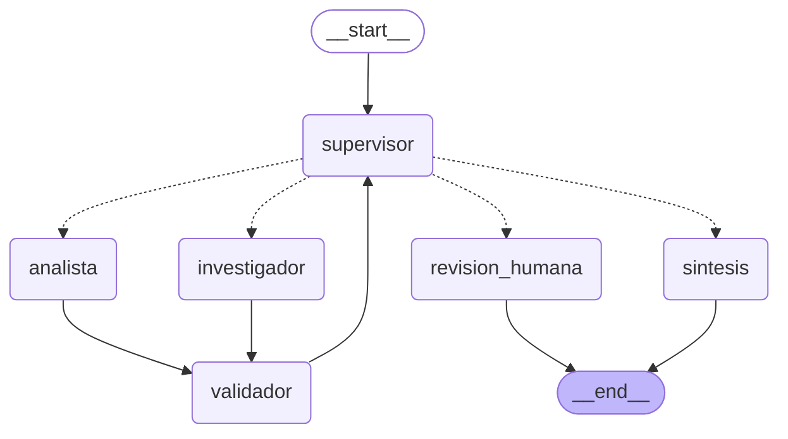

# Orquestador Multi-Agente de Análisis e Investigación

Pre-entrega 6 — AI Engineering (Clase 6: sistemas multi-agente). Orquestador **jerárquico y asíncrono** sobre LangGraph que resuelve preguntas que necesitan **dos dominios de especialización** (investigación y cómputo) más una **síntesis final**, sobre las políticas internas de TechCorp.

Qué demuestra:

- **Jerarquía con delegación dinámica**: un Supervisor (LLM con salida estructurada `Literal`) decide quién interviene o si termina. No hay ruta fija.
- **Especialización con herramientas acotadas**: el Investigador solo consulta políticas; el Analista solo usa una calculadora segura (`ast`, sin `eval`).
- **Estado compartido estructurado**: cada especialista escribe solo en su parcela, con artefactos Pydantic. El estado registra quién aportó qué, quién decidió qué y por qué, y qué fue aprobado.
- **Validación antes de cerrar**: un nodo `validador` determinístico (código, no otro LLM) revisa cada salida. Si falla, el supervisor reenvía el **error específico** al mismo especialista. Si no se resuelve, **escala a revisión humana**.
- **Parada estricta** (anti "Supervisor Infinito"): tope de pasos, tope de reparaciones, detección de repetición y `recursion_limit`.

## Diagrama del grafo

Generado con `graph.get_graph().draw_mermaid()` (`python main.py --export-graph` → [docs/grafo.mmd](docs/grafo.mmd) y [docs/grafo.png](docs/grafo.png)).




## Topología elegida y por qué

**Jerárquica (estrella con un controlador central) con compuerta de validación.** Todo especialista termina en el `validador` y de ahí vuelve siempre al `supervisor`; los especialistas nunca hablan entre sí. `sintesis` y `revision_humana` son los únicos nodos que cierran el grafo.

| Decisión | Alternativa descartada | Por qué |
|---|---|---|
| Topología **jerárquica** | Cooperativa / blackboard | La consigna la pide; el flujo es predecible y auditable en un solo punto, los módulos son reemplazables y las decisiones se validan con código. El cuello de botella del supervisor se mitiga con guardrails deterministas que no dependen del LLM. |
| Nodo `validador` **entre** cada especialista y el supervisor | Validar solo al final | Evita que un dato inventado llegue al Analista, que calcularía "con confianza" sobre algo falso. La rúbrica del prompt queda como segunda defensa (suficiencia, completitud). |
| El validador es **código** | Agente crítico con LLM | Un modelo puede ser persuasivo y estar equivocado; dos agentes con el mismo modelo base pueden alucinar lo mismo. Un crítico LLM además reintroduce el bucle infinito de corrección. |
| Supervisor con `with_structured_output(DecisionSupervisor)` + `enrutar -> Literal[...]` | Parsear texto libre | Lo pide la consigna. Si el LLM falla, el nodo escala con `ERROR_SUPERVISOR` en vez de romper. |
| `create_agent` + `ToolStrategy(Esquema)` | `create_react_agent` | `create_agent` es el sucesor de `create_react_agent` en LangGraph/LangChain 1.x (importar este último emite `LangGraphDeprecatedSinceV10`). Mismo patrón, con `response_format` Pydantic. |
| Un LLM **por rol** inyectado en `Dependencias` | `llm` global | Permite un modelo mayor para el supervisor (`SUPERVISOR_MODEL`) y fakes guionados por rol en los tests. |

## Cómo se manejan los conflictos entre agentes

| Conflicto | Mecanismo | Dónde |
|---|---|---|
| Dos agentes escriben el mismo dato | Parcelas de escritura aisladas + reducers; ningún nodo lee-modifica-escribe | `state.py` |
| El Investigador cita algo que no recuperó | `CITA_NO_ENCONTRADA` / `FUENTE_NO_RECUPERADA`: la cita debe estar **textualmente** en la salida de la herramienta | `validation.verificar_investigacion` |
| El valor no está respaldado por la cita | `VALOR_NO_RESPALDADO` | ídem |
| El Analista reporta algo distinto de lo que devolvió la calculadora | `RESULTADO_INCONSISTENTE` (recomputa) / `SIN_USO_DE_HERRAMIENTA` | `validation.verificar_analisis` |
| El Analista usa números "de memoria" | `OPERANDO_SIN_ORIGEN` (advertencia o error según `OPERANDOS_ESTRICTOS`) | ídem |
| El Investigador no encuentra el dato | `estado="sin_evidencia"`; no se calcula con datos inventados; cierre `INCOMPLETO` | prompt + `calcular_estado_final` |
| Un especialista lanza una excepción | Capturada en el nodo → `ERROR_ESPECIALISTA` → reparación | `agents/*_agent.py`, `validator.py` |
| **Supervisor vs. validador** (el LLM quiere `FINISH` pero la validación falló) | **Manda el validador**: G2 fuerza la reparación (`REPARACION_FORZADA`) | `aplicar_guardrails` |
| Reparación que no converge | `MAX_REPARACIONES` → `revision_humana` (`VALIDACION_IRRESOLUBLE:<agente>`) | G2 |
| Ping-pong sin progreso | G3 + G1 + `recursion_limit` | `aplicar_guardrails`, `graph.configuracion` |

**Guardrails del supervisor** (funciones puras sobre la decisión del LLM: el LLM propone, el código dispone):

- **G1** tope `MAX_PASOS` (default 6) → escala.
- **G2** validación fallida → repara al mismo especialista hasta `MAX_REPARACIONES`, luego escala.
- **G3** misma instrucción a un especialista ya aprobado → cierra.
- **G4** no se puede finalizar sin que algún especialista haya trabajado.

No se implementa un árbitro con LLM: con dos especialistas de dominios distintos, el árbitro es la verificación determinística contra la evidencia.

## Estado compartido: quién escribe qué

| Campo | Escribe | Reducer |
|---|---|---|
| `research_output`, `research_evidence`, `research_error` | solo el Investigador | sobrescritura |
| `analysis_output`, `analysis_tool_results`, `analysis_error` | solo el Analista | sobrescritura |
| `validacion`, `aprobaciones`, `fallos_validacion` | solo el Validador | `fusionar` / `sumar_contadores` |
| `next_agent`, `instruccion`, `decisiones`, `estado_final`, `motivo_escalamiento` | solo el Supervisor | sobrescritura / `operator.add` |
| `contribuciones` | todos (registro de auditoría) | `operator.add` |
| `pasos`, `intentos` | especialistas | `operator.add` / `sumar_contadores` |

## Arquitectura

| Módulo | Responsabilidad |
|---|---|
| `state.py` | `AgentState(MessagesState)`, reducers, `estado_inicial()` |
| `schemas.py` | Contratos Pydantic: artefactos, decisión del supervisor, validación, auditoría |
| `config.py` / `llm.py` | `Settings` inmutables desde `.env`; factory del LLM (OpenAI, Anthropic, Google opcional) |
| `prompts.py` | Prompts versionados |
| `validation.py` | Validadores determinísticos puros |
| `agents/` | `research_agent`, `analyst_agent`, `supervisor` (+ guardrails y `enrutar`), `validator`, `synthesis`, `_common` |
| `tools/` | `calculator.py` (calculadora segura), `retrieval.py` (corpus, BM25 local, Pinecone) |
| `graph.py` | `build_graph`, `compilar`, `configuracion` (con `recursion_limit`) |
| `faults.py` | Inyección determinística de fallas (solo demo y tests) |
| `tracing.py` / `escenarios.py` | Traza "quién decidió qué y por qué" y 8 escenarios con verificaciones |
| `main.py` / `demo.py` | CLI de una pregunta y runner de escenarios |

## Agentes y herramientas

- **Investigador** — `buscar_en_politicas_internas`. Backend `local` (BM25 propio, sin red) o `pinecone` (el RAG híbrido de la Pre-entrega 4).
- **Analista** — `calculadora`: aritmética con `ast`, sin `eval`; exponente ≤ 100, longitud ≤ 200, rechaza `bool`/`str`, división por cero y resultados no finitos.
- **Contexto mínimo**: ningún especialista recibe `state["messages"]`. `armar_prompt_especialista` construye un único mensaje con la instrucción (y, para el Analista, solo los hallazgos **aprobados**).

## Requisitos

- Python 3.12.
- API key de OpenAI (o Anthropic con `LLM_PROVIDER=anthropic`). Pinecone es opcional.
- Costo de la demo completa con `gpt-4o-mini` y backend local: ≈ 60 000 tokens (< USD 0,05).

## Cómo levantar el entorno

PowerShell:

```powershell
py -3.12 -m venv .venv
.\.venv\Scripts\Activate.ps1
pip install -r requirements.txt
copy .env.example .env    # completar OPENAI_API_KEY (o ANTHROPIC_API_KEY + LLM_PROVIDER=anthropic)
pytest -q
python main.py --export-graph
python demo.py
```

bash:

```bash
python3.12 -m venv .venv && source .venv/bin/activate
pip install -r requirements.txt && cp .env.example .env
pytest -q && python main.py --export-graph && python demo.py
```

Si el repo vive bajo OneDrive y algo se bloquea (`.venv`, `.git`), moverlo a una carpeta no sincronizada.

## Uso

```powershell
python main.py "¿Cuántos días de vacaciones tiene alguien con 12 años?" --verbose   # una pregunta, flujo en vivo
python main.py --export-graph                                                         # docs/grafo.mmd (+ .png con red)
python demo.py                                                                        # 8 escenarios → traces/
python demo.py --strict                                                               # exit 1 si alguna verificación falla
python demo.py --backend pinecone --salida traces/pinecone                           # con el RAG real
python scripts/build_notebook.py --execute                                            # regenera demo_delegacion.ipynb
```

Uso programático:

```python
import asyncio
from config import Settings
from escenarios import Escenario, ejecutar_escenario


async def main() -> None:
    esc = Escenario("Q", "Consulta", "-", "¿Cuántos días de vacaciones tiene alguien con 12 años?", lambda t: [])
    traza = await ejecutar_escenario(esc, Settings.from_env())
    print(traza.respuesta)


asyncio.run(main())
```

## Ejemplo de traza de ejecución (real)

Generada por `python demo.py` con `gpt-4o-mini` y backend `local`; no se editó a mano. Completa en [traces/traza_ejecucion.log](traces/traza_ejecucion.log) y [traces/traza_ejecucion.json](traces/traza_ejecucion.json).

**E1 — flujo completo (investigador → analista → síntesis)**

```text
[1] supervisor decide → investigador (llm)
      razón: Falta el dato específico sobre los días de vacaciones que corresponden por año según la política de la empresa.
      rúbrica: completitud ✘ · respaldo ✘ · consistencia ✘
[2] investigador (intento 1): estado=completo, 3 hallazgo(s), confianza=1.00
      herramienta: buscar_en_politicas_internas(pregunta="días de vacaciones por año") → [Fuente: politica_vacaciones.txt] ...
[3] validador ✔ investigador aprobado
[4] supervisor decide → analista (llm)
      instrucción: "Calcular ... Usar el valor 28 días por año y multiplicar por 3 años."
[5] analista (intento 1): 28 * 3 = 84 (confianza=1.00)
      herramienta: calculadora(expresion="28 * 3") → Resultado: 84
[6] validador ✔ analista aprobado
[7] supervisor decide → FINISH (llm)
      rúbrica: completitud ✔ · respaldo ✔ · consistencia ✔
[8] sintesis: respuesta redactada
(COMPLETADO · 2 paso(s) de especialista · 8 nodos · 10.7 s · 7121 tokens)
```

**E2 — ruteo dinámico: la pregunta ya trae los números, el supervisor omite al investigador**

```text
[1] supervisor decide → analista (llm)
      razón: Ya están todos los números disponibles y falta un cálculo.
[2] analista (intento 1): (14*5) + (21*5) + (28*2) = 231 (confianza=1.00)
[3] validador ✔ analista aprobado
[4] supervisor decide → FINISH (llm)
(COMPLETADO · 1 paso(s) de especialista · 5 nodos · 6.5 s · 3746 tokens)
```

**E5 — reparación: el validador rechaza un cálculo inconsistente (falla inyectada)**

```text
[5] analista (intento 1): 28 * 3 = 85 (confianza=1.00)
      herramienta: calculadora(expresion="28 * 3") → Resultado: 84
[6] validador ✘ analista RECHAZADO: [RESULTADO_INCONSISTENTE] La expresión '28 * 3' da 84, pero reportaste resultado=85. Reportá exactamente el valor que devuelve la calculadora.
[7] supervisor decide → analista (llm)
      instrucción: "... [REPARACIÓN] Tu salida anterior fue rechazada por el validador determinístico. Salida anterior: {...}"
[8] analista (intento 2): 28 * 3 = 84 (confianza=1.00)
[9] validador ✔ analista aprobado
(COMPLETADO · 3 paso(s) de especialista · 11 nodos · 14.2 s · 10098 tokens)
```

**E8 — validación irresoluble → revisión humana (anti Supervisor Infinito)**

```text
[11] analista (intento 3): 28 * 3 = 85 (confianza=1.00)
[12] validador ✘ analista RECHAZADO: [RESULTADO_INCONSISTENTE] ...
[13] supervisor decide → ESCALAR (guardrail)
      razón: La validación de 'analista' sigue fallando tras 2 reparaciones.
      guardrail: VALIDACION_IRRESOLUBLE
[14] revision_humana: respuesta redactada
(REQUIERE_REVISION_HUMANA · motivo: VALIDACION_IRRESOLUBLE:analista · 4 paso(s) de especialista · 14 nodos · 18.3 s · 12873 tokens)
```

**Estructura de `traza_ejecucion.json`**: `metadata` (proveedor, modelo, backend, topes, versiones de prompts y librerías) → `escenarios[]` (pregunta, `eventos[]` por nodo, `respuesta`, `estado_final`, `motivo_escalamiento`, `intentos`, `fallos_validacion`, `aprobaciones`, `research_output`, `analysis_output`, `decisiones[]`, `tokens`, `verificaciones[]`) → `resumen`.

### Resultados de las corridas reales

| Corrida | Verificaciones | Tokens | Archivos |
|---|---|---|---|
| OpenAI `gpt-4o-mini`, backend `local` | **42/42** | 59 587 | `traces/traza_ejecucion.*` |
| OpenAI `gpt-4o-mini`, backend `pinecone` | **41/42** | 1 087 721 | `traces/pinecone/traza_ejecucion.*` |

Escenarios (E1–E8): E1 flujo completo · E2 solo cómputo · E3 solo investigación · E4 tres tramos en un cálculo · E5 reparación · E6 sin evidencia · E7 excepción de un especialista · E8 validación irresoluble.

**Limitación documentada (Pinecone, E6).** Con el backend `pinecone` la verificación `estado_final == INCOMPLETO` de E6 falla. Pinecone siempre devuelve los k vecinos más cercanos, aunque no sean relevantes, y el Investigador reintenta buscando hasta agotar `ESPECIALISTA_TIMEOUT_S` (60 s). El flujo no se rompe: el `TimeoutError` se captura, el validador lo rechaza, y tras agotar las reparaciones el sistema escala a `revision_humana` (`VALIDACION_IRRESOLUBLE:investigador`) en lugar de inventar un dato. Esa corrida consumió ≈ 1,09 M de tokens por los reintentos. Con el backend `local` (devuelve vacío cuando no hay coincidencias) E6 pasa. Mejora posible: un umbral de score en el retriever o un tope de llamadas a la herramienta por intento.

**Ajuste de prompt (v1 → v2).** La primera corrida con `supervisor-v1` dio 39/42: en E4 el supervisor se saltó al Investigador y escribió en su instrucción "14 días por año de antigüedad" de memoria (el analista calculó 308 en vez de 63). `supervisor-v2` aclara que los años de antigüedad mencionados en la pregunta no son datos de la política. Con v2: 42/42.

## Demostración

[demo_delegacion.ipynb](demo_delegacion.ipynb) — ejecutado con salidas: topología, flujo completo (E1), estado compartido y log de decisiones, ruteo dinámico (E2 y E3) y camino de fallo (E5, E7, E8).

## Prompts versionados

| Rol | Versión vigente |
|---|---|
| Supervisor | `supervisor-v2` |
| Investigador | `investigador-v1` |
| Analista | `analista-v1` |
| Síntesis | `sintesis-v1` |

Regla: **si cambiás un prompt, subí la versión** (en `PROMPT_VERSIONES` y en el texto). La versión queda en la metadata de la traza. Historial: `supervisor-v1` → `v2` (ver arriba).

## Cómo se cumple la consigna

| Requisito | Dónde se ve |
|---|---|
| ≥ 2 dominios + síntesis final | E1; `agents/research_agent.py`, `analyst_agent.py`, `synthesis.py` |
| Topología jerárquica con Supervisor | `agents/supervisor.py`, `graph.py`; diagrama arriba |
| ≥ 2 especialistas con herramienta funcional | `buscar_en_politicas_internas`, `calculadora` |
| Estado compartido que rastree quién aportó qué | `state.py` (`contribuciones`, `decisiones`, parcelas aisladas); E4 |
| El supervisor decide si está completo o si se refina | rúbrica en `SUPERVISOR_PROMPT` + G2 + E5 |
| `AgentState` hereda de `MessagesState` (`next_agent`, `task_completed`) | `state.py` |
| `StateGraph`, `add_node`, conditional edges con `Literal` | `graph.py`, `enrutar` en `agents/supervisor.py` |
| Prueba: supervisor → investigador → analista → cierre | E1 y notebook |
| Anti Supervisor Infinito | G1–G4, `MAX_PASOS`, `recursion_limit`, E8 |
| Anti contaminación de contexto | `armar_prompt_especialista`; `test_flujos.py::test_contexto_acotado_el_analista_no_ve_la_conversacion` |
| Nodo de validación o rúbrica antes del END | **ambos**: `agents/validator.py` + rúbrica del prompt |
| README con diagrama y explicación de topología y conflictos | este documento |
| Log de quién decidió qué y por qué | `decisiones` + `traces/traza_ejecucion.log` |
| Versionar prompts; probar el camino de fallo | `PROMPT_VERSIONES`; E5–E8 |
| Notebook o video del flujo de delegación | `demo_delegacion.ipynb` |

## Tests y calidad

```powershell
pytest -q                      # 56 passed, offline (LLM guionados), ~5 s
ruff check . ; ruff format --check .
mypy                           # strict
python demo.py --strict        # 42/42 con LLM real
```

Los tests no usan red ni API keys: un `FakeToolCallingModel` guionado hace de especialista, de síntesis y de supervisor. Devuelve `model_copy(deep=True)` de cada mensaje para no caer en el reemplazo por `id` de `add_messages`.

## Seguridad

- `.env` fuera del repo (`.gitignore`); en el repo solo `.env.example`.
- Las keys se declaran con `repr=False` en `Settings` y nunca se loguean.
- Calculadora sin `eval`; herramientas de solo lectura.

## Limitaciones y mejoras

- Corpus de 4 documentos; ejecución secuencial de especialistas (paralelizable con `asyncio.gather` si son independientes).
- El Investigador con Pinecone puede reintentar en exceso cuando no hay evidencia (ver E6 arriba).
- `revision_humana` informa y cierra; un human-in-the-loop real usaría `interrupt()` con un checkpointer.
- Mejoras: árbitro con LLM por *provenance*, observabilidad con LangSmith, evaluación con un set mayor de preguntas.
